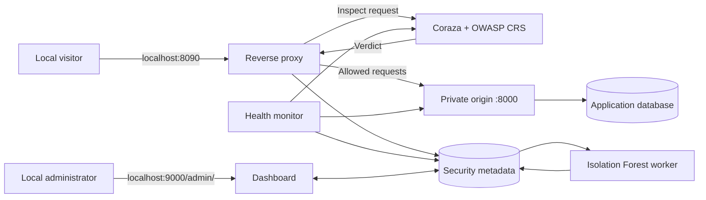

# Web Security Gateway

A local cybersecurity lab combining a reverse proxy, **Coraza WAF with OWASP Core Rule Set**, progressive rate limiting, and **ML-assisted anomaly review**. The gateway and dashboard run separately from the protected application.

Built as an internship engineering project. The bundled applications use fictional data and have no government branding or integration. This repository is a reproducible lab, not a production security service or a guarantee against every attack.

## Capabilities

| Component | What it does |
| --- | --- |
| WAF | Inspects requests with Coraza and OWASP CRS before forwarding them. |
| Rate limiting | Enforces per-peer limits and expiring blocks; repeat violations increase the penalty. |
| Monitoring | Checks origin and WAF health; groups repeated incidents into local dashboard notifications. |
| Dashboard | Shows real traffic statistics, rule IDs, latency, block history, and audit events. Indonesian interface with locally bundled Chart.js. |
| Machine learning | Uses Isolation Forest on approved traffic metadata; findings require administrator review. |
| Reporting | Exports filtered event metadata as CSV or JSON, with additional health and incident context in JSON. |
| Application isolation | Keeps the origin private and allows administrators to select only explicitly configured lab origins. |

## Architecture



Only the gateway and administrator interface publish host ports, both on **127.0.0.1**. The WAF is an internal inspection service, not a second public proxy. See [architecture and decision flow](docs/ARCHITECTURE.md).

## Quick start — Windows PowerShell

Requirements: Git, Python 3.10+, and Docker Desktop with Linux containers and Compose v2. Docker must be running. The first build requires internet access. Ports **8090** and **9000** must be available.

```powershell
git clone https://github.com/Boas04/web-security-gateway.git
cd web-security-gateway/ruang-guard
python -m venv .venv
.\.venv\Scripts\python -m pip install -r requirements.txt
.\.venv\Scripts\python setup.py
Copy-Item .env.example .env
docker compose -p ruang-guard config --quiet
docker compose -p ruang-guard up -d --build
docker compose -p ruang-guard ps
curl.exe -i http://localhost:8090/api/health
```

These initialization commands are for a **fresh clone**. Preserve existing secrets and `.env` when upgrading.

- Protected portal: **http://localhost:8090**
- Administrator dashboard: **http://localhost:9000/admin/**
- Read the generated password locally from `ruang-guard/secrets/initial-password.txt`. Login requires a password, not a default username. Never commit this file.
- A successful portal health request returns HTTP 200 and `{"environment":"fictional-local-lab","status":"ok"}`. This JSON is output, not a PowerShell command.

For Linux/macOS commands, troubleshooting, credentials, and shutdown instructions, use the [installation guide](docs/INSTALLATION.md).

## Documentation

| Guide | Contents |
| --- | --- |
| [Panduan Bahasa Indonesia](docs/PANDUAN_ID.md) | Instalasi, penggunaan, pengujian awal, dan pemecahan masalah. |
| [Installation](docs/INSTALLATION.md) | Prerequisites, fresh setup, updates, and shutdown. |
| [Usage and configuration](docs/USAGE.md) | Dashboard, complaint workflow, limits, origins, exports, and logs. |
| [Architecture](docs/ARCHITECTURE.md) | Services, networks, request decisions, and data handling. |
| [Testing](docs/TESTING.md) | Unit, real-WAF, integration, and ML evaluation procedures. |
| [Verification](docs/VERIFICATION.md) | Checks actually run for this publication and remaining limits. |
| [ML lifecycle — Bahasa Indonesia](ruang-guard/ML_GUIDE.md) | Baseline approval, training, validation, activation, and rollback. |
| [WAF/ML coordination — Bahasa Indonesia](ruang-guard/COORDINATION_GUIDE.md) | Decision matrix, administrator response, and model quarantine. |
| [Security boundaries](SECURITY.md) | Threat model, limitations, and safe issue reporting. |
| [Third-party notices](ruang-guard/THIRD_PARTY.md) | Bundled browser dependency and dependency references. |

## Repository structure

```text
web-security-gateway/
  docs/                 Installation, operation, architecture, testing
  ruang-guard/          Gateway, dashboard, monitor, ML, WAF, integration Compose
    guard/              Python services and dashboard assets
    waf/                Go inspection service using Coraza/CRS
    config/             Explicit origin allowlist
    demo-app/           Optional fictional catalog origin
    tests/              Policy, WAF, integration, and ML tests
  ruang-warga/          Independent fictional complaint portal
```

Keep the two application folders adjacent: the integrated Compose build references `../ruang-warga`. Run the integrated lab from **ruang-guard**, not the standalone portal Compose file.

## Security and ML scope

Default public limits are 120 requests per 60 seconds. A new block lasts 72 seconds; repeated violations after expiry double it up to 3,600 seconds. Requests during an active block do not extend it. Clients behind the same NAT can share a limit because untrusted forwarding headers are not accepted.

ML runs asynchronously on metadata and never cancels a WAF denial. New installations have **no active model**; learning requires explicitly approved baseline data, candidate training, validation, and activation. An ML outage does not bypass WAF protection. A WAF outage causes the gateway to fail closed with HTTP 503.

The system does not provide volumetric DDoS mitigation, high availability, multi-tenant isolation, or production HTTPS management. Application validation and access control remain necessary. See [SECURITY.md](SECURITY.md).

## Attribution and licensing

Project author: **Abner Boas Paskah Parningotan Gultom**. Coraza, OWASP CRS, Chart.js, scikit-learn, and the other dependencies are third-party projects; this repository integrates them and does not claim to implement their engines or algorithms from scratch.

Third-party components retain their upstream licenses. No project-wide license grant for the original code is included at this time; a public repository alone does not grant unrestricted reuse rights.
