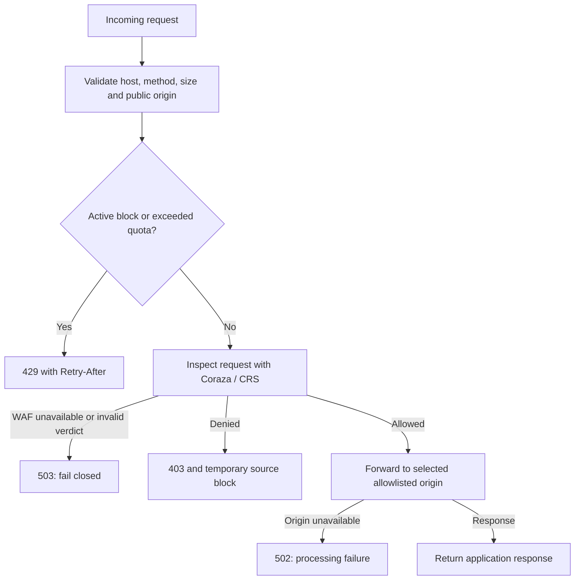

# Architecture and security decisions

[Back to README](../README.md)

## Services and boundaries

| Service | Responsibility | Host publication | Storage |
| --- | --- | --- | --- |
| gateway | Validation, rate/block policy, WAF delegation, origin forwarding | 127.0.0.1:8090 → 8080 | Security SQLite |
| waf | Go service using Coraza and OWASP CRS | None; internal 8081 | No persistent request payloads |
| admin | Authenticated dashboard and administrative APIs | 127.0.0.1:9000 → 9000 | Security SQLite |
| monitor | Origin/WAF probes, alerts, retention | None | Security SQLite |
| ml-worker | Metadata windows, training, inference, coordination | None | Security SQLite |
| portal | Fictional complaint application | None; internal 8000 | Separate portal SQLite |
| demo-app | Optional fictional catalog | None; internal 8000 | Fictional application data |

The gateway joins `edge`, `inspection`, and `origin`. WAF joins only `inspection`; the monitor joins `inspection` and `origin`. The dashboard has its own `admin` network and does not connect directly to the origin or inspector. ML uses an internal `analysis` network. The `origin`, `inspection`, and `analysis` networks are internal. No container mounts the Docker socket.

The security database is shared by the Python services through a named volume. This is a single-host lab architecture with shared trust in those services, not microservice database isolation or a distributed production control plane. Application and security databases are separate.

## Request decisions

This is a simplified flow; invalid requests can be rejected during validation or by the HTTP server before application logging. WAF decisions use the request that will be forwarded. The gateway retains application validation, parameterized queries, and complaint access-key checks in the origin.

## WAF and ML coordination

Coraza evaluates request content synchronously. Isolation Forest evaluates completed one-minute metadata windows asynchronously. The model is not a SQLi/XSS classifier and is not on the request critical path.

ML cannot override WAF denials. Conflicting evidence becomes a review case. A current, validated suspicious finding can support a bounded administrator-requested block after explicit review; ML does not silently block clients. An unavailable ML worker leaves WAF/rate-limit enforcement in place. An unavailable WAF still closes the gateway with 503.

The [ML guide](../ruang-guard/ML_GUIDE.md) describes baseline selection and model lifecycle. The [coordination guide](../ruang-guard/COORDINATION_GUIDE.md) documents evidence checks, response limits, model integrity, and quarantine.

## Metadata and retention

Event records contain timestamps, source HMACs, methods, normalized route labels, HTTP status, policy reasons, rule IDs, and latency. They exclude raw query strings, headers, bodies, passwords, access tokens, and original IP addresses. Unknown routes become `[other]`. The WAF sees request contents in memory but does not persist raw audit/debug payloads.

Traffic, health, and audit retention is bounded to 10,000 rows and seven days by the monitor. Therefore chart totals represent retained matching records, not all-time traffic. ML windows are also bounded; model baseline snapshots have separate lifecycle rules. Public event aggregates can span selected-origin changes; ML datasets/models are origin-specific.

Local HTTP is intentional for the loopback lab. Administrator sessions use HttpOnly/SameSite cookies and CSRF checks, but production Secure-cookie/HTTPS deployment, trusted edge-proxy design, account management, and availability engineering remain outside this edition.
